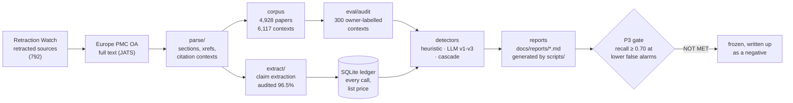

# RetractionScope — Claim-Level Dependency on Retracted Papers: a measured study

**When a paper is retracted, which claims in other papers actually depended on it — not merely cited it?**

Citation-level alerts answer "everything that cites this." RetractionScope aims at the sentence the
citation sits in, decides whether that sentence *relies on* the retracted work, and does so at a cost
that is measured on every step rather than assumed.

> **Status: FROZEN study. The P3 gate is NOT PASSED.**
>
> The detector does not beat the cheap baseline where it matters, the frozen test set was never
> evaluated (a deliberate choice, not an oversight), and the last stage that could have lifted recall
> — claim linking — was tested and dropped on evidence. Nothing here is a product claim, and no
> experiment will be re-run to make the gate pass. The results below are final as recorded.

| | |
| :-- | :-- |
| **Phase** | P3 — blast radius (baselines, gold audit, staged detector, claim linking) |
| **Gate status** | ❌ **NOT PASSED** — see [the gate section](#the-gate-not-passed) |
| **Frozen** | 2026-11-21 · tag `retractionscope-v1-frozen` |
| **Real spend** | **$0** (free tier, billing off; every call still ledgered at list price) |
| **Test set** | frozen and hash-locked, **never evaluated** (`test_evaluated: false`) |
| **Runtime** | Python 3.11 · `ruff` · `mypy` strict · pytest — **509 passed, 3 skipped** from a clean clone |
| **First name** | Developed in Nov 2026 under the working name Axion V2. Renamed RetractionScope on 2026-11-21 when Axion V2 was redefined as the upgrade of the Axion V1 product. This study is frozen. |

---

## The problem, concretely

Retractions arrive in batches — paper-mill takedowns, proceedings purges — and faster than review
capacity grows. Downstream impact is currently computed by citation: paper B cites retracted paper A,
so B is flagged.

That signal is nearly useless at scale, because a citation carries no information about load. Of
**300 human-labelled citation contexts** in this corpus, only **37 (12.3%)** genuinely rely on the
retracted work. The other 263 are background, credit, a list of prior findings, a comparison, or a
mention of the retraction itself. An alert that fires on all 300 is right 12% of the time, and the
people receiving it learn to ignore it.

The interesting question is therefore not "does B cite A" but "would B's sentence have to change if
A's claim were false" — and the interesting engineering question is whether that can be answered
cheaply enough to matter. This study answers the first question as far as the data allows and prices
the second honestly, including where it failed.

## Results: the frozen measured numbers

Every figure comes from a committed report generated by a script in this repo. Corpus and cost
figures are as measured; splits are stated because they matter.

| Result | Number (split) | Report |
| :-- | :-- | :-- |
| Corpus | **4,928 papers** built around **792 retracted source papers**, **6,117 citation contexts**; only **285 of 792** sources have any in-corpus citer edge | [`P1-corpus.md`](docs/reports/P1-corpus.md) |
| Claim extraction precision | **96.5%** [93.0, 98.3], **193/200** audited claims over **45 papers**; **recall unmeasured** (no exhaustive gold set exists) | [`P1-audit.md`](docs/reports/P1-audit.md) |
| Gold set | **300** labelled contexts, **37 `RELIES_ON`**, **21 of them in test**; split **by source paper** (34 dev / 34 test sources) | [`P3-03-wave1-wave2-metrics.md`](docs/reports/P3-03-wave1-wave2-metrics.md) |
| Cost cascade (`escalation-length30`) | **−55.6%** $/paper ($0.002505/paper) at test precision **98.2%**, **retention 56.7%** (55/97) — the miss; no measured configuration reaches 90% retention | [`P2-cascade.md`](docs/reports/P2-cascade.md) |
| Heuristic detector (frozen test, text-bearing frame) | recall **83.3%** [60.8, 94.2] at false-alarm rate **38.0%** [28.8, 48.2] on **18 positives** — wide intervals, stated as such | [`P3-04-baselines.md`](docs/reports/P3-04-baselines.md) |
| Citation-level floor | recall 100% by construction, **false alarms 100%**, precision 16.4% | [`P3-04-baselines.md`](docs/reports/P3-04-baselines.md) |
| LLM detector v3 (**dev**, 148 of 151 rows) | recall **50.0%** [26.8, 73.2] at false alarms **12.2%** [7.2, 19.7] | [`P3-05-llm-v2-calibration.md`](docs/reports/P3-05-llm-v2-calibration.md) |
| Staged cascade (**dev**) | recall **42.9%** [21.4, 67.4] at false alarms **12.0%**, escalation rate `e` = 45.0% | [`P3-05-detector-dev.md`](docs/reports/P3-05-detector-dev.md) |
| Claim-linking oracle (**dev**) | a correct source sentence changed nothing: positives caught **6 of 11 before, 6 of 11 after**; 18 of 22 scores identical | [`P3-06-oracle-result.md`](docs/reports/P3-06-oracle-result.md) |
| $/retraction analysed | **$0.00232** list price per retracted paper, end to end (projection to the full corpus is labelled PROJECTED) | [`P3-08-cost-scaffold.md`](docs/reports/P3-08-cost-scaffold.md) |

Costs are **list price recorded in a SQLite ledger on every call**. Actual spend is $0 because the
study ran on a provider free tier with billing off — the discipline is that the number would be real
if billing were on. Two-labeler agreement was **61 overlap rows, 100% raw agreement, κ 1.000 by
degeneracy (zero discordant pairs)** — that is a *consistency check*, not evidence of reliability,
and it is written up that way.

### The gate: NOT PASSED

P3's gate is: **beat the citation-level baseline on false alarms at recall ≥ 0.70** (ratified target
≥ 0.80). It is not met, and the repo records it as not met:

- The best cascade reaches **42.9% recall at 12.0% false alarms** on dev. The heuristic reaches
  **83.3% recall at 38.0% false alarms** on test. The cascade is the more precise, much less
  sensitive operating point; it does not dominate, and it does not reach 0.70.
- The LLM stage alone reaches **50.0% recall at 12.2% false alarms** on dev. Every dev threshold
  that clears 0.70 recall also fires on more than four negatives in five.
- The **test set was never evaluated**. The spec is frozen (`6612eae9cbf24a60`) and
  `test_evaluated: false`; the single permitted look was deliberately not spent on a detector known
  to miss the dev floor ([ADR-0026](docs/DECISIONS.md), [ADR-0027](docs/DECISIONS.md)).
- Claim linking, the one stage that could have raised recall, was tested with a 22-request oracle and
  moved nothing — so it was **not built**, by a rule written down before the labels existed.

A results table that only shows a project's good phase is an advertisement, not a lab notebook. This
one carries its miss.

## What was built

- **Corpus and extraction** — Retraction Watch → Europe PMC, JATS parsing, deterministic citation
  contexts from `xref` markers, claim extraction audited at 96.5% precision.
- **Gold set** — 300 contexts, two sampling waves, stratified by section and source paper,
  paper-level dev/test split frozen before any detector existed.
- **Baselines** — citation-level, section/lexical heuristic, LLM-only; test computed once, frozen,
  and later runs refuse if a frozen number moved.
- **Staged detector** — deterministic features, three LLM prompt variants (v1, v2, v3) with a
  pre-registered variant cap, calibrated escalation, `e` measured at 45%.
- **Cost accounting** — `$` per context and per retraction from the ledger, with the pre-run estimate
  reconciled against the actual spend.
- **Claim linking** — diagnosed, then tested as an oracle experiment (a human picked the true source
  sentence for 30 rows) and dropped on evidence.

## What was NOT built

- **Propagation rule v2** — `src/axion/propagate/` is a stub. No trust propagation exists.
- **Demo, dashboard, API** — `src/axion/api/` is a stub; `docker-compose.yml` runs Neo4j only.
- **Student model for this task** — the P2 student classifies claims, not dependency; `s` is reported
  as **not applicable** rather than invented.
- **A test-set number** — the frozen test was never scored.

## Pipeline



## Repository map

| Path | What is in it |
| :-- | :-- |
| `src/axion/` | the code: `ingest/` (Europe PMC), `parse/` (JATS, contexts), `extract/` (claims, stages), `link/` (candidates, dependency detector), `llm/` (client, ledger, pacing), `eval/`, `store/`, `train/`; `propagate/` and `api/` are stubs |
| `scripts/` | every experiment and report generator — the only way a number is produced |
| `tests/` | 510 offline tests; network tests are opt-in |
| `eval/` | gold labels, frozen baselines, detector outputs, audit tooling |
| `docs/` | `PRD.md`, `DECISIONS.md` (ADRs), `PROGRESS.md`, phase `TODO.md`s, `reports/` |
| `data/` | gitignored: raw Europe PMC responses, Neo4j export, `ledger.sqlite3` |
| `config`, `pricing.yaml` | corpus selection, stages, list prices with effective dates |

## How to reproduce

Honest status, per step:

| Step | Works from a clean clone? |
| :-- | :-- |
| `pip install -e ".[dev]"`, `pytest`, `ruff`, `mypy` | **Yes** — verified by extracting `git archive HEAD` into an empty directory with no `.env` and no `data/`: 509 passed, 3 skipped, 0 failed (one extra skip needs the gitignored baseline labels) |
| `make report` (the P1 baseline report) | **Yes**, from the committed manifest |
| Re-running the corpus build / extraction | **Only with a live Europe PMC key and hours of fetching**; `data/` is gitignored, so raw responses are not in the repo |
| Re-running any detector, cascade or LLM run | **No** — needs `GEMINI_API_KEY` and free-tier quota; outputs are committed instead, and re-running would not reproduce identical model answers |
| Regenerating the cost tables | **Partly** — script reads the repo's frozen artefacts, but the ledger itself (`data/ledger.sqlite3`) is not committed, so dollar figures are re-derived from committed per-run summaries, not re-summed |

So: the *tests* and the *P1 report* reproduce from a clean clone; the *measurements* are reproductions
of committed artefacts, not fresh experiments. That limitation is stated rather than papered over.

## Negative results this repo publishes

1. **More teacher labels stopped helping.** Quality on the frozen gold test was flat from 10 to 98
   labelled papers, so labelling stopped 202 papers short of its ceiling — money not spent, written up
   as a negative result ([`P2-student.md`](docs/reports/P2-student.md)).
2. **The cascade buys cost at a retention price.** −55.6% $/paper at 98.2% precision, but it keeps
   only **56.7%** of the baseline's claims. The cost gate is met; the quality story is weak and is
   labelled as such ([`P2-cascade.md`](docs/reports/P2-cascade.md)).
3. **The flywheel did not reduce escalation.** Retraining on escalated cases left held-out `e` at
   **8.3% → 8.3%** ([`P2-05b-flywheel.md`](docs/reports/P2-05b-flywheel.md)).
4. **Title-only rows are not free negatives.** The stub stratum was expected to be near-certain
   negatives; **3 of 34 were `RELIES_ON`** ([`P3-03-wave1-metrics.md`](docs/reports/P3-03-wave1-metrics.md)).
5. **An LLM asked for a class gives you a coin, not a probability.** Prompt v1 was near-silent
   (16.7% test recall); prompt v2 returned **111 rows ≤ 30, zero rows between 31 and 70, 40 rows
   ≥ 70** — a decision wearing a number's clothes ([`P3-05-llm-v2-calibration.md`](docs/reports/P3-05-llm-v2-calibration.md)).
6. **The linkage hypothesis was wrong.** Giving the detector the *correct* source sentence, chosen by
   a human from the paper's body, changed nothing: **6 of 11 positives caught before and after**
   ([`P3-06-oracle-result.md`](docs/reports/P3-06-oracle-result.md)).
7. **Perfect agreement can be uninformative.** Both labelers agreed on all 61 overlap rows, so κ is
   1.000 *by degeneracy* and says nothing about the rubric's borderline cases.

## How the numbers stay honest

- **Every reported table is generated by a script** in [`scripts/`](scripts) and committed with the
  report. If it cannot be regenerated here, it is not claimed here.
- **The test suite is hermetic.** CI runs it on Linux from a clean clone with no `.env` and no local
  data; two tests were found there that had been passing only because a developer's `.env` existed,
  and they were fixed rather than excused.
- **Labels are human; machines only advise.** Every label used in a reported metric was applied by a
  human — the owner (`Soham`) for the gold sets, a second independent labeler (`friend`) for the
  overlap. Machine output appears only as **silver training data** and is never evaluated against
  itself. Model scores are detector outputs, not labels.
- **Splits are by paper**, not by row, so a paper cannot appear on both sides of a threshold.
- **The test set is frozen before the detector exists.** A spec hash is written to
  `eval/audit/p3-05/p3-05-spec-frozen.json`; later runs recompute and *refuse to continue* if a
  frozen number moved. A baseline added after the freeze carries its own `added_at` stamp.
- **Rates come with intervals.** Wilson for proportions, cluster bootstrap when rows share a paper.
  With 18 text-bearing test positives, "not distinguishable" is a legitimate and expected outcome.
- **Cost is reported with quality, always.** A result without a price is an incomplete result.
- **LLM calls go through one client.** No ad hoc model calls: the client owns retries, pacing,
  caching and the ledger, so a call that is not in the ledger does not exist.

## Quickstart

Requires **Python 3.11**; on Windows use `.venv\Scripts\activate`.

```bash
pip install -e ".[dev]"
pytest -q            # 509 passed, 3 skipped from a clean checkout (network tests opt-in)
ruff check . && mypy
make report          # regenerate the P1 baseline report
```

Detection, cost and evaluation scripts live in [`scripts/`](scripts); each report in
[`docs/reports/`](docs/reports) names the command that produced it.

## Cite this work

See [`CITATION.cff`](CITATION.cff). If you use the gold labels or the corpus counts, cite this
repository and the tag `retractionscope-v1-frozen`.

## Licence and lineage

MIT (see [`LICENSE`](LICENSE)). Started as a clean-room successor to
[Axion V1](https://github.com/Som007-builds/Axion) (MIT); the rename history is recorded in
[`FORMERLY.md`](FORMERLY.md).
