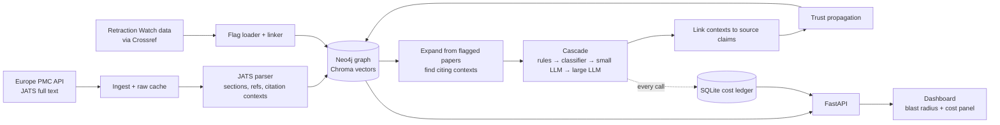

# Architecture (planned)

See `CONTEXT.md §7` for stack and data model; this file is the design overview and will be updated as components land.

## Design principles
- Deterministic stages first; cost attributed per stage via `stage` and `run_id` on every derived edge and ledger row.
- Idempotent loaders; content/ID keys; cache before models.
- Evaluation is a first-class component (`eval/`), with frozen splits and regenerable reports.

## Component responsibilities (target)
| Component | Responsibility | LLM |
| :-- | :-- | :-: |
| `ingest/` | Europe PMC and retraction-data clients, raw cache | no |
| `parse/` | JATS → structured document + citation contexts | no |
| `extract/` | cascade stages, claim extraction | yes (late stages) |
| `link/` | dependency detection and context→claim linking | yes (ambiguous only) |
| `propagate/` | trust propagation rule v2 | no |
| `llm/` | `LLMClient`, providers, cache, ledger | — |
| `store/` | Neo4j, Chroma, SQLite access | no |
| `api/` | read endpoints, cost summaries | no |

## Open design questions (resolve via ADR)
- Granularity of claim linking (sentence vs. claim object).
- Transitive propagation depth and decay.
- Handling of retracted papers with missing/partial full text.
