# Architecture (planned)

See `CONTEXT.md §7` for stack and data model; this file is the design overview and will be updated as components land. The scale story is recorded in ADR-0008: **teach once, run cheap, escalate rarely, process lazily.**

## Scale layers

| Layer | What runs | Model calls? |
| :-- | :-- | :-: |
| **0 — Deterministic** | Ingest, JATS parse, citation contexts, dedup, content-hash cache | no |
| **1 — Students** | Claim-sentence detector and citation-reliance classifier trained on teacher silver labels | no |
| **2 — Escalation** | Low-confidence items go to a small LLM, then a large LLM; escalated cases become new silver labels | yes, rare |
| **3 — Lazy/incremental** | Risk-ordered queue, hash-keyed idempotent runs, hot corpus first, cold corpus later | no |

```mermaid
flowchart LR
    EPMC[Europe PMC API<br/>JATS full text] --> ING[Layer 0: ingest + raw cache]
    CR[Retraction Watch data<br/>via Crossref] --> FLAG[Flag loader + linker]
    ING --> PARSE[JATS parser<br/>sections, refs, citation contexts]
    PARSE --> STORE[(Neo4j graph<br/>Chroma vectors)]
    FLAG --> STORE
    STORE --> SCHED[Layer 3: scheduler<br/>risk-ordered hot/cold queue]
    SCHED --> EXP[Expand from flagged papers<br/>find citing contexts]
    EXP --> L0[Layer 0: rules + dedup + cache]
    L0 --> STU[Layer 1: students<br/>claim detector / reliance classifier]
    STU -->|confident| LINK[Link contexts to source claims]
    STU -->|low confidence| SMALL[Layer 2: small LLM]
    SMALL -->|confident| LINK
    SMALL -->|low confidence| LARGE[Layer 2: large LLM]
    LARGE -->|resolved| LINK
    SMALL -->|labels| SILVER[(Silver label store)]
    LARGE -->|labels| SILVER
    SILVER --> TRAIN[Student training<br/>paper-level splits + gold eval]
    TRAIN --> STU
    LINK --> PROP[Trust propagation]
    PROP --> STORE
    L0 -. ledger .-> LEDGER[(SQLite ledger<br/>llm_calls + training_runs)]
    SMALL -. ledger .-> LEDGER
    LARGE -. ledger .-> LEDGER
    TRAIN -. training runs .-> LEDGER
    LEDGER --> PROJ[scripts/cost_model.py<br/>MEASURED vs PROJECTED]
    STORE --> API[FastAPI]
    LEDGER --> API
    API --> WEB[Dashboard<br/>blast radius + cost panel + projection]
```

## Design principles
- Deterministic stages first; cost attributed per stage via `stage`, model `tier`, and `parent_call_id` on ledger rows and derived edges.
- Idempotent loaders; content/ID keys; cache before models; process each paper once unless new evidence arrives.
- Silver labels train; gold labels evaluate. Splits are by paper, never by claim/context. The gold test is frozen.
- Evaluation is a first-class component (`eval/`), with regenerable reports and manifests/hashes for large label artifacts.
- Projections are generated from the ledger by script and are always labeled **PROJECTION** with assumptions and ranges.

## Component responsibilities (target)
| Component | Responsibility | LLM |
| :-- | :-- | :-: |
| `ingest/` | Europe PMC and retraction-data clients, raw cache | no |
| `parse/` | JATS → structured document + citation contexts | no |
| `schedule/` | priority queue, hot/cold states, incremental/hash-cached work | no |
| `extract/` | deterministic stages, student inference, claim extraction | late stages only |
| `link/` | dependency detection and context→claim linking | ambiguous only |
| `train/` | teacher silver labeling, student training, gold evaluation | teacher only |
| `llm/` | `LLMClient`, providers, cache, ledger, escalation links | — |
| `store/` | Neo4j, Chroma, SQLite access (labels, `training_runs`) | no |
| `eval/` | gold audit sets, silver manifests/hashes, frozen splits | no |
| `scripts/cost_model.py` | ledger-driven cost projection with ranges/sensitivity | no |
| `propagate/` | trust propagation rule v2 | no |
| `api/` | read endpoints, cost summaries, projection view | no |

## Open design questions (resolve via ADR)
- Granularity of claim linking (sentence vs. claim object).
- Transitive propagation depth and decay.
- Handling of retracted papers with missing/partial full text.
- Student architecture, label budget, and calibration/conformal method for escalation thresholds.
- How much of the silver-label store is committed (manifests + hashes vs. row-level labels).
